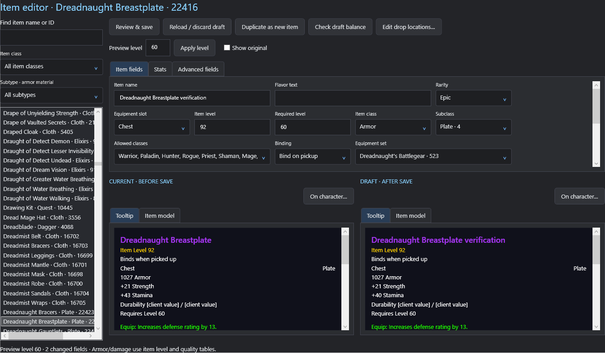
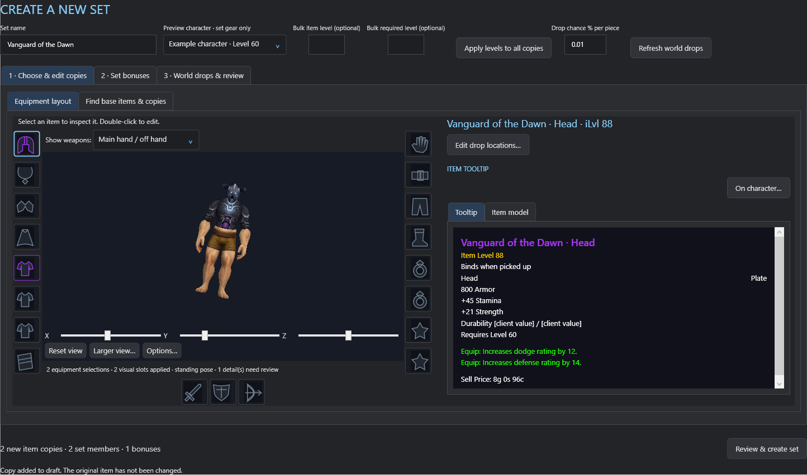

# WoWItemEditor

Windows desktop editor for compatible World of Warcraft Classic 1.60.1 server data, with MariaDB-backed item, spell and proc catalogs, character equipment previews and custom set creation.

[Download the Windows preview](https://github.com/marcpnut/WoWItemEditor/releases) · [Folder guide](docs/ARCHITECTURE.md)

## Warning: database edits can brick your server

**Use at your own risk. Modifying MariaDB data with this application can brick your server: invalid or incompatible changes may cause crashes, prevent startup, corrupt gameplay data, or make the server unusable until a backup is restored.** Validation and editor history cannot guarantee that every change is safe, and the editor's history database is not a full server backup.

Before editing, make complete, restorable backups of your world, hotfix and character databases and any other databases your server uses. Keep a known-good server configuration and game-data backup. Test changes on a separate server/database copy before using them on a live server, and confirm you know how to restore your backups. You are responsible for the changes you apply.

## Editing guides

[Edit or duplicate items](docs/guides/items.md) · [Create and modify gear sets](docs/guides/gear-sets.md) · [Configure weapon procs](docs/guides/weapon-procs.md) · [Recover active edits after an upgrade](docs/guides/active-change-recovery.md)

## Quests (untested)

Create and edit quests, copy existing quest-giving NPCs, place them using a saved character location, and configure objectives and rewards. **Quest functionality is untested in WoW.** Verify NPC placement, the ! marker, quest acceptance, objectives and rewards on a test server. See the [quest creator guide (untested)](docs/guides/quest-creator-local.md).

## Screenshots

Item editing with current and draft tooltip comparisons:

Set creation with a live character model, equipment slots and duplicated items:

Weapon-proc editing with spell assignments and trigger settings:

The guides include more screens for set membership and bonuses. Screenshots show verification fixtures and draft changes; they contain no saved character details or connection credentials.

## Get started

1. Install the .NET 10 SDK on Windows to build from source.
2. Run **START_EDITOR.bat**, or build with `dotnet build WoWItemEditor.slnx -c Release`.
3. First-run setup asks for your MariaDB connection and extracted game-data folders. You can change them later using **Settings…** at the bottom of the sidebar.
4. Use **Test connection** to check access to your hotfix, world and character databases without changing their data.

A self-contained Windows build can be created with `dotnet publish src/WoWItemEditor/WoWItemEditor.csproj -c Release -r win-x64 --self-contained true -o publish`. Run WoWItemEditor.exe from that folder. Each user supplies their own server connection and game data.

## Settings

- MariaDB host, port, user, password, TLS mode and connection timeout.
- Separate hotfix, world, character and editor history/backup database names.
- Extracted DB2 folder containing ItemSparse.db2, usually data/dbc/enUS. Choose server data root to fill DB2 and maps together.
- Extracted maps folder for world-drop area matching.
- WoW installation root containing .build.info and Data for textured 3D models.
- Optional local MariaDB installation/tools folder, retained as a reference. Connections use the configured host and port; the app does not manage the database service.
- Whether to download missing client model assets into the local cache.

Settings are encrypted with Windows DPAPI for the current Windows account in %LOCALAPPDATA%/WoWItemEditor/settings.dat. Passwords are masked, never stored in the repository and never included in a published build. Connection and folder changes apply after restarting so an existing editing session cannot silently switch servers. Existing local installations migrate their saved connection and retain the legacy history database and table names for compatibility.

## Features

- Characters opens at startup. Items, spells and procs preload concurrently; catalog navigation reuses memory snapshots. Refresh reloads server data, and set/proc saves invalidate the reference cache.
- Owned items on the left, saved character appearance and equipment slots on the right. Search all equipable armor/weapons for preview-only swaps. Double-click an item to edit its shared definition for everyone on the server.
- Native textured item and character models, saved customization choices, first-frame standing pose, rotation sliders, drag rotation and Shift-drag across all axes. Choose Main hand / off hand or Ranged; only that weapon group is displayed.
- Searchable item, spell and proc catalogs with readable armor, effect, aura and trigger filters.
- Item duplication and editing; custom set creation and membership editing; set-specific spell values; weapon proc selection; world or selected instance-boss drops.
- Original/current tooltip comparisons, review before saving, conflict checks and retained history with revert/reapply. Weapon scaling checks reject unsupported native damage rows.
- Created-set loading shows an indeterminate progress bar and member-by-member status. Membership changes remain drafts until reviewed and saved.

## Compatibility and data

This app targets the existing Classic 1.60.1 data layout (server DB2 build 70450; compatible installed client 1.60.1). Changing database names does not make another expansion/schema compatible. Game files, client textures, extracted DB2/maps, database contents, credentials and runtime caches are not distributed here. Users must provide their own compatible data.

At startup the app automatically creates the configured backup database and missing editor history tables with CREATE IF NOT EXISTS. Existing records are preserved. If the account lacks permissions, startup explains the missing privileges; no PowerShell setup is required for an account with the required access. The connection test itself stays read-only.

Server editing needs privileges for the relevant hotfix/world tables and the editor's history tables/backup database. Character inventory is read for previews; gear try-on does not move real items. Set/item saves change shared server data. Keep server backups and test edits before applying them to a live server.

Model effects and some customization details are approximated. Some native skin choices have near-black source textures; the viewer reports this rather than substituting a different saved skin. Stats are server-table previews; unsupported scaling contexts are marked. See [model viewer notes](docs/MODEL_VIEWER_PLAN.md), [roadmap](docs/ROADMAP.md) and [third-party notices](licenses/THIRD_PARTY_NOTICES.md) for implementation details and third-party notices.

## Verification

- `--verify-settings`: encrypted round-trip, invalid identifier rejection, folder validation and settings screen render. Does not overwrite real settings.
- `--verify-storage`: editor history initialization, repeated setup and missing-privilege guidance; an isolated test database is removed if the account can create it.
- `--verify-startup`: startup catalogs, shared load, cached navigation and timings.
- `--verify-character-model`: outfit rendering, saved character previews, weapon display switching and catalog filters.
- `--verify`: editor/history/drop regression suite; database edit scenarios roll back their transactions.

Run a built WoWItemEditor executable with the chosen flag. Verification output stays in the ignored artifacts folder and may contain local character/item data; do not publish that folder.

This project is not affiliated with Blizzard Entertainment. Third-party package licenses remain applicable; see [third-party notices](licenses/THIRD_PARTY_NOTICES.md).

## Repository layout

- `src/WoWItemEditor/`: WPF application, organized into configuration, data access, feature logic, rendering, reusable controls and views.
- `tests/WoWItemEditor.Verification/`: existing in-app verification scenarios, linked into the app to exercise internal editors and WPF windows.
- `docs/`: architecture, roadmap, model viewer and server safety notes.
- `licenses/`: dependency notices and license texts.
- `artifacts/`: ignored local builds, screenshots and verification reports.

Open `WoWItemEditor.slnx` in your IDE, or run `dotnet build` from the repository root. See [architecture and folder guide](docs/ARCHITECTURE.md) for where to put new code.
