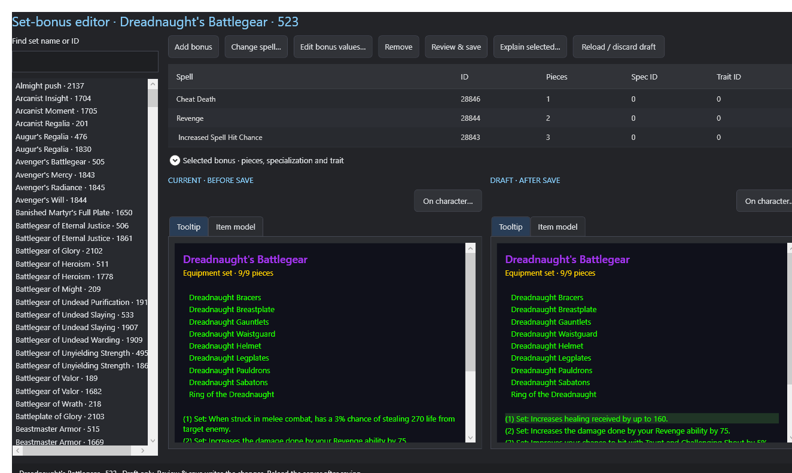
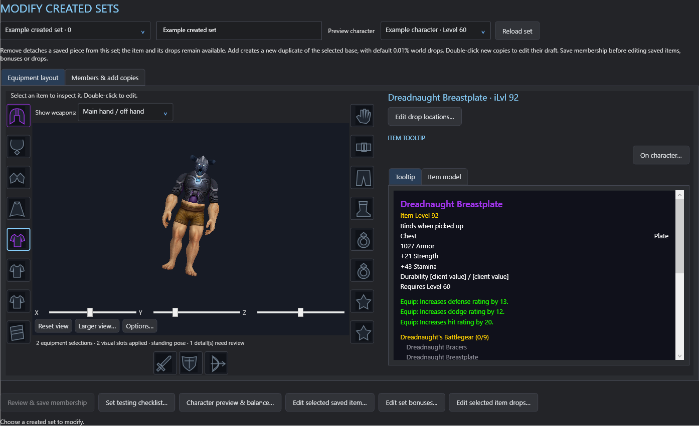

# Create and modify gear sets

[Back to README](../../README.md) · [Items](items.md) · [Weapon procs](weapon-procs.md)

## Create a new set

1. Open **Set creator** and enter the set name. **Preview character · set gear only** starts with the character selected in the main screen; choose another saved character there if needed. The 3D model uses that character's saved appearance but starts unequipped. Adding or removing copies updates the model; current inventory equipment is not imported.
2. In **1 · Choose & edit copies**, use **Find base items & copies** to pick an equipment slot and search/filter base items. Choose **Add duplicate to this slot**. Each selection becomes a separate new item on save; the base remains unchanged.
3. Repeat for the desired slots. Empty slots are allowed. Two-hand weapons reserve both hands. Shirt and tabard can be outfit copies, but do not count toward the client's 17-member set limit.
4. Select a piece in **Equipment layout** to inspect its tooltip; double-click it or use **Edit copy draft** to change that copy. In this context **Apply to set draft** returns the item changes to the pending set; the final set save persists them.
5. Optional bulk item/required levels use **Apply levels to all copies**. Inspect the resulting item previews before saving.

## Configure set bonuses

1. Open **2 · Set bonuses** and add a bonus spell. Search by ID, name or description, with school, effect, aura and trigger filters. The aura dropdown also accepts readable terms such as modify crit.
2. Set the required piece count. Apply row settings to the draft where the form provides that action.
3. Use **Edit bonus values…** to change supported values for that set. Read the effect explanation, units and allowed bounds; the editor makes a set-specific spell copy rather than changing the shared original.
4. Use **Explain selected…** and the tooltip preview to understand the result. Existing set bonuses can also be opened from the sidebar **Set bonuses** editor. **Change spell…** selects a replacement spell; it is different from editing the current bonus's values.

## Choose drops and save

1. Open **3 · World drops & review**. Default world drops use **0.01% per piece** on eligible creatures in level-appropriate areas, before server multipliers.
2. Select a copy and use **Choose instance & boss / world drops…** to assign its drop plan. Boss assignments replace that copy's world drops.
3. Check all items, bonus thresholds, target levels and drop rates, then choose **Review & create set** and confirm the reviewed changes.

## Modify a saved created set

1. Open **Modify created sets** and choose the set. A loading bar and member-by-member message show what is being read.
2. Use **Equipment layout** to inspect/select members. In **Members & add copies**, add a base as a new duplicate or remove a member from the draft. Removing a saved member detaches it from the set; its item and existing drops are preserved.
3. Choose **Review & save membership** to persist membership changes before opening saved-item, bonus or drop editors.
4. Use **Edit selected saved item…**, **Edit set bonuses…** or **Edit selected item drops…** for further changes. Double-click a saved equipment piece to open its item editor.
5. Use **Character preview & balance…** and **Set testing checklist…** to review the complete result. **Reload set** reloads the selected set and can discard pending membership edits.

Only active sets created by this editor appear in Modify created sets. Use the separate Set bonuses editor to change bonuses on an existing native set. Changes to a saved item are shared by every server instance of that item ID.

Screenshots use disposable verification fixtures. Their set names, thresholds and balance values are examples, not recommended game design. Follow the editor's reload guidance and check the result in game after saving.
