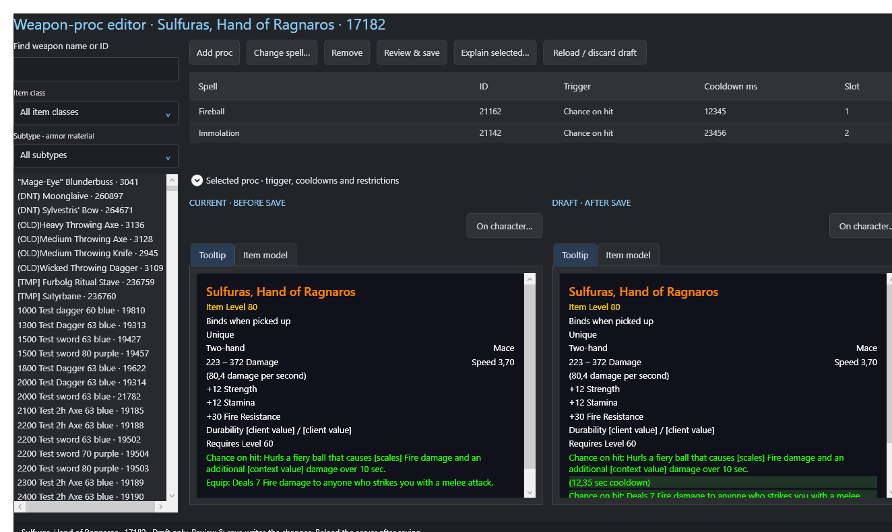

# Edit weapon procs

[Back to README](../../README.md) · [Items](items.md) · [Gear sets](gear-sets.md)

## Find the weapon and effect

1. Open **Weapon procs** in the sidebar and search for the weapon name or ID. Item class/material filters narrow the weapon list.
2. Select a weapon to load its configured effects. Inspect the current tooltip and effect rows before changing anything.
3. Choose **Add proc** for a new assignment, or select a row and choose **Change spell…** to replace its spell. **Remove** removes the selected assignment from the draft.
4. In the spell/template picker, search by name, ID or description. Use the readable effect/aura, school, usage, description and trigger filters to find the appropriate template.

The **Spell catalog** lists all available spell definitions. The **Proc catalog** lists item effects and spells with proc rules. Both catalogs support searching and trigger filters; selecting a catalog entry does not itself change a weapon.

## Set trigger and timing

1. Select the effect row and expand **Selected proc · trigger, cooldowns and restrictions**.
2. Choose the **Trigger**. For an attack proc this is typically **Chance on hit**; **Equip** and **Use** describe different activation behavior.
3. Set supported cooldown, charge, slot and restriction fields as needed. Cooldowns are in **milliseconds**: 1000 ms is one second. Preserve special/default values unless the explanation and your server's behavior justify a change.
4. Choose **Apply row settings to draft**. Editing these form fields alone does not commit the row or save the weapon.
5. Use **Explain selected…** to read the effect semantics, proc defaults and available server proc rules. A trigger name is not a proc chance. This editor assigns item effects and edits their row settings; it does not provide unrestricted editing of shared spell definitions or global proc-rule probabilities.

## Review and save

Compare **CURRENT · BEFORE SAVE** with **DRAFT · AFTER SAVE**, then choose **Review & save** and confirm the reviewed changes. The selected weapon's definition changes for everyone on the server. **Reload / discard draft** restores the saved assignments.

Set-specific bonus values belong in the [set-bonus editor](gear-sets.md#configure-set-bonuses). Use Change history to inspect retained changes and revert/reapply them when needed. Follow the editor's reload guidance and test actual proc behavior in game: a tooltip preview does not simulate combat triggers, talents or all server rules.

The screenshot contains verification-only draft cooldowns and assignments; do not treat them as recommended gameplay values.
